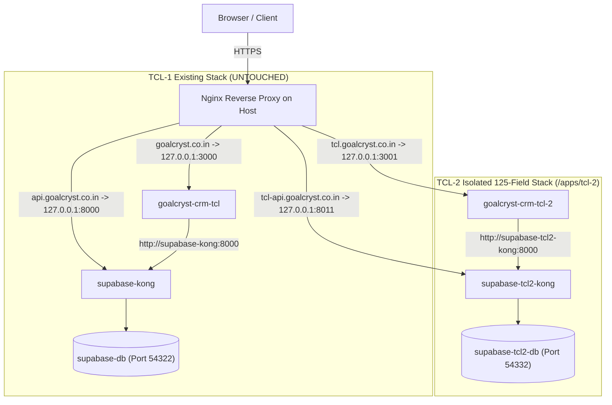

# GoalCryst CRM TCL-2 — Complete Isolated Production Architecture & Deployment Plan

## 1. Dual-Stack Isolation Architecture (TCL-1 vs. TCL-2)

**TCL-1** and **TCL-2** operate as **100% isolated stacks** on the production VPS (`goalcryst`). Each has its own Next.js container, dedicated self-hosted Supabase stack, dedicated PostgreSQL database volume, isolated Docker bridge network, dedicated Nginx subdomains, and isolated browser auth cookie names.



### Side-by-Side Comparison Matrix

| Resource | TCL-1 (Existing — DO NOT TOUCH) | TCL-2 (New 125-Field Stack) |
| :--- | :--- | :--- |
| **Frontend Domain** | `https://goalcryst.co.in` | `https://tcl.goalcryst.co.in` |
| **Supabase API Domain** | `https://api.goalcryst.co.in` | `https://tcl-api.goalcryst.co.in` |
| **App Host Port** | `3000` -> `3000` | `127.0.0.1:3001` -> `3000` |
| **Kong API Host Port** | `127.0.0.1:8000` -> `8000` | `127.0.0.1:8011` -> `8000` |
| **Postgres Host Port** | `54322` -> `5432` | `127.0.0.1:54332` -> `5432` |
| **App Container Name** | `goalcryst-crm-tcl` | `goalcryst-crm-tcl-2` |
| **App Image Tag** | `goalcryst-crm-tcl:latest` | `goalcryst-crm-tcl-2:latest` |
| **App Compose Project** | *(existing)* | `tcl2` |
| **Supabase Compose Project** | *(existing)* | `supabase-tcl2` |
| **Docker Network** | `supabase_default` | `supabase-tcl2_default` |
| **Internal Kong DNS** | `http://supabase-kong:8000` | `http://supabase-tcl2-kong:8000` |
| **Auth Cookie Name** | `sb-goalcryst-auth` | `sb-goalcryst-tcl2-auth` |
| **App Directory** | `/home/goalcryst/crm-project` | `/apps/tcl-2/app` |
| **Supabase Directory** | `/home/goalcryst/crm-project/supabase-prod` | `/apps/tcl-2/supabase-tcl2` |
| **DB Persistent Volume** | `/home/goalcryst/crm-project/supabase-prod/volumes/db/data` | `/apps/tcl-2/supabase-tcl2/volumes/db/data` |

---

## 2. Phase 1 — Capture Read-Only Baseline on VPS

Before any action on the VPS, record the baseline state of TCL-1 and its Supabase stack:

```bash
mkdir -p /apps/tcl-2/baseline
docker ps --format "table {{.Names}}\t{{.Image}}\t{{.Status}}\t{{.Ports}}" | tee /apps/tcl-2/baseline/docker-ps.before.txt
docker network ls | tee /apps/tcl-2/baseline/networks.before.txt
findmnt /apps/tcl-2 | tee /apps/tcl-2/baseline/mounts.before.txt
df -h | tee /apps/tcl-2/baseline/df.before.txt
ss -tulpn | grep -E ':(3000|3001|8000|8011|54322|54332)\b' | tee /apps/tcl-2/baseline/ports.before.txt
```

---

## 3. Phase 2 — Provision Isolated Supabase Stack for TCL-2 (`/apps/tcl-2/supabase-tcl2`)

All TCL-2 database and Supabase files reside on the dedicated 93 GB `/apps/tcl-2` (`app2-lv`) logical volume.

### Step 3.1: Clone Supabase Docker Template into `/apps/tcl-2/supabase-tcl2`
Copy the self-hosted Supabase Docker configuration structure (excluding `volumes/db/data` and runtime state) or clone official Supabase Docker config into `/apps/tcl-2/supabase-tcl2`:

```bash
mkdir -p /apps/tcl-2/supabase-tcl2
rsync -av \
  --exclude='volumes/db/data' \
  --exclude='volumes/storage' \
  --exclude='volumes/logs' \
  /home/goalcryst/crm-project/supabase-prod/ \
  /apps/tcl-2/supabase-tcl2/
```

### Step 3.2: Isolate Container Names, Ports, and URLs in `/apps/tcl-2/supabase-tcl2`
1. **Update `/apps/tcl-2/supabase-tcl2/docker-compose.yml`**:
   - Rename container prefixes from `supabase-*` to `supabase-tcl2-*` (`supabase-tcl2-db`, `supabase-tcl2-kong`, `supabase-tcl2-auth`, `supabase-tcl2-rest`, `supabase-tcl2-realtime`, `supabase-tcl2-storage`, `supabase-tcl2-meta`, `supabase-tcl2-studio`, `supabase-tcl2-pooler`).
   - Change host port mappings to non-conflicting ports:
     - `KONG_HTTP_PORT`: `127.0.0.1:8011:8000`
     - `POSTGRES_PORT`: `127.0.0.1:54332:5432`
     - `STUDIO_PORT`: `127.0.0.1:54333:3000`
   - Set default network name to `supabase-tcl2_default`.
2. **Update `/apps/tcl-2/supabase-tcl2/.env`** (`chmod 600`):
   - `SITE_URL=https://tcl.goalcryst.co.in`
   - `API_EXTERNAL_URL=https://tcl-api.goalcryst.co.in`
   - `SUPABASE_PUBLIC_URL=https://tcl-api.goalcryst.co.in`
   - `KONG_HTTP_PORT=8011`
   - `POSTGRES_PORT=54332`

### Step 3.3: Start Isolated TCL-2 Supabase Stack
```bash
cd /apps/tcl-2/supabase-tcl2
docker compose -p supabase-tcl2 up -d
```

### Step 3.4: Apply the Clean 125-Field TCL-2 Schema (`supabase/migrations/20261020000000_tcl2_baseline.sql`)
Once `supabase-tcl2-db` is healthy, apply the single baseline schema (base tables, auth sync, RLS policies, RPCs, and the six 125-field contract tables `contracts`, `contract_contacts`, `contract_assets`, `contract_financials`, `contract_legal`, `contract_bureau_scores`). **Fresh installs only.**

```bash
# Apply every file in supabase/migrations in name order (baseline first, then later changes)
for f in /apps/tcl-2/app/supabase/migrations/*.sql; do
  echo "Applying $f"
  docker exec -i supabase-tcl2-db psql -U postgres -d postgres -v ON_ERROR_STOP=1 < "$f" || break
done
```

### Step 3.5: Moving an EXISTING TCL-2 database to the clean schema (one time, destructive)
`supabase/upgrade/tcl2-reset-to-clean-125.sql` deletes all imported contract data and everything linked to a contract (call dispositions, waiver requests, import history), then rebuilds the contract tables with the 125 template fields. Users, permissions, disposition setup, waiver reasons and audit logs are kept. It runs in one transaction.

```bash
# 1. Backup first
docker exec supabase-tcl2-db pg_dump -U postgres -d postgres -Fc > /apps/tcl-2/backups/pre-clean-$(date +%Y%m%d-%H%M).dump
# 2. Apply
docker exec -i supabase-tcl2-db psql -U postgres -d postgres -v ON_ERROR_STOP=1 < /apps/tcl-2/app/supabase/upgrade/tcl2-reset-to-clean-125.sql
# 2b. Apply migrations newer than the baseline (team-scoped follow-ups/dashboard)
docker exec -i supabase-tcl2-db psql -U postgres -d postgres -v ON_ERROR_STOP=1 < /apps/tcl-2/app/supabase/migrations/20261023000000_team_scoped_visibility.sql
# 3. Refresh the API schema cache
docker restart supabase-tcl2-rest
```
Apply it **before** starting the new app build, then re-import the data file from the Bulk Import page.

---

## 4. Phase 3 — Configure & Deploy TCL-2 Next.js Application (`/apps/tcl-2/app`)

### Step 4.1: Clone TCL-2 Repository
```bash
git clone -b main https://github.com/savistatech/goalcryst-crm-tcl-2.git /apps/tcl-2/app
cd /apps/tcl-2/app
```

### Step 4.2: Create `/apps/tcl-2/.env.production`
```bash
cp /apps/tcl-2/app/.env.production.example /apps/tcl-2/.env.production
chmod 600 /apps/tcl-2/.env.production
```
Populate `/apps/tcl-2/.env.production`:
```ini
NEXT_PUBLIC_SUPABASE_URL=https://tcl-api.goalcryst.co.in
NEXT_PUBLIC_SUPABASE_ANON_KEY=<TCL2_SUPABASE_ANON_KEY>
SUPABASE_INTERNAL_URL=http://supabase-tcl2-kong:8000
SUPABASE_SERVICE_ROLE_KEY=<TCL2_SUPABASE_SERVICE_ROLE_KEY>
```

### Step 4.3: Validate, Build, and Start `goalcryst-crm-tcl-2` on Port `3001`
```bash
cd /apps/tcl-2/app

docker compose \
  --env-file /apps/tcl-2/.env.production \
  -p tcl2 \
  -f compose.production.yaml \
  config --quiet

docker compose \
  --env-file /apps/tcl-2/.env.production \
  -p tcl2 \
  -f compose.production.yaml \
  build

docker compose \
  --env-file /apps/tcl-2/.env.production \
  -p tcl2 \
  -f compose.production.yaml \
  up -d
```

---

## 5. Phase 4 — Configure Nginx Reverse Proxy & HTTPS for `tcl.goalcryst.co.in` and `tcl-api.goalcryst.co.in`

Create a dedicated Nginx configuration at `/etc/nginx/sites-available/goalcryst-tcl2` (leaving the existing `goalcryst.co.in` and `api.goalcryst.co.in` configs untouched):

```nginx
# 1. TCL-2 Frontend Application (tcl.goalcryst.co.in -> 127.0.0.1:3001)
server {
    listen 80;
    server_name tcl.goalcryst.co.in;

    client_max_body_size 500M;

    location / {
        proxy_pass http://127.0.0.1:3001;
        proxy_http_version 1.1;
        proxy_set_header Upgrade $http_upgrade;
        proxy_set_header Connection 'upgrade';
        proxy_set_header Host $host;
        proxy_set_header X-Real-IP $remote_addr;
        proxy_set_header X-Forwarded-For $proxy_add_x_forwarded_for;
        proxy_set_header X-Forwarded-Proto $scheme;
        proxy_cache_bypass $http_upgrade;
        proxy_read_timeout 300s;
        proxy_send_timeout 300s;
    }
}

# 2. TCL-2 Supabase Kong API Gateway (tcl-api.goalcryst.co.in -> 127.0.0.1:8011)
server {
    listen 80;
    server_name tcl-api.goalcryst.co.in;

    client_max_body_size 50M;

    location / {
        proxy_pass http://127.0.0.1:8011;
        proxy_http_version 1.1;
        proxy_set_header Upgrade $http_upgrade;
        proxy_set_header Connection 'upgrade';
        proxy_set_header Host $host;
        proxy_set_header X-Real-IP $remote_addr;
        proxy_set_header X-Forwarded-For $proxy_add_x_forwarded_for;
        proxy_set_header X-Forwarded-Proto $scheme;
        proxy_cache_bypass $http_upgrade;
    }
}
```

Enable and issue Let's Encrypt TLS certificates:
```bash
ln -s /etc/nginx/sites-available/goalcryst-tcl2 /etc/nginx/sites-enabled/goalcryst-tcl2
nginx -t && systemctl reload nginx
certbot --nginx -d tcl.goalcryst.co.in -d tcl-api.goalcryst.co.in
```

---

## 6. Phase 5 — Verification & Health Checks

```bash
# 1. Verify TCL-2 container health & logs
docker ps --filter "name=goalcryst-crm-tcl-2"
docker logs --tail 100 goalcryst-crm-tcl-2

# 2. Verify local health check and login endpoints
curl -i http://127.0.0.1:3001/api/health
curl -sS -o /dev/null -w 'TCL-2 Login HTTP: %{http_code}\n' http://127.0.0.1:3001/login

# 3. Verify TCL-2 Kong API gateway on port 8011
curl -sS -o /dev/null -w 'TCL-2 Kong HTTP: %{http_code}\n' http://127.0.0.1:8011/rest/v1/

# 4. Confirm TCL-1 (port 3000 & 8000) remains 100% operational and untouched
curl -sS -o /dev/null -w 'TCL-1 Login HTTP: %{http_code}\n' http://127.0.0.1:3000/login
docker ps --format "table {{.Names}}\t{{.Status}}\t{{.Ports}}" | grep -v tcl2
```

---

## 7. Routine Update & Rollback Runbook

### Safe Update Procedure (`tcl2` Only)
```bash
cd /apps/tcl-2/app
git rev-parse HEAD > /apps/tcl-2/baseline/last-working-commit.txt
git fetch origin main
git pull --ff-only origin main

docker compose --env-file /apps/tcl-2/.env.production -p tcl2 -f compose.production.yaml build
docker compose --env-file /apps/tcl-2/.env.production -p tcl2 -f compose.production.yaml up -d
curl -f http://127.0.0.1:3001/api/health
```

### Instant Rollback Procedure (`tcl2` Only)
```bash
cd /apps/tcl-2/app
docker logs --tail 500 goalcryst-crm-tcl-2 > /apps/tcl-2/baseline/rollback-$(date +%Y%m%d-%H%M%S).log
docker compose --env-file /apps/tcl-2/.env.production -p tcl2 -f compose.production.yaml stop

# Optional: roll back to last working commit and restart
git checkout $(cat /apps/tcl-2/baseline/last-working-commit.txt)
docker compose --env-file /apps/tcl-2/.env.production -p tcl2 -f compose.production.yaml build
docker compose --env-file /apps/tcl-2/.env.production -p tcl2 -f compose.production.yaml up -d
```
