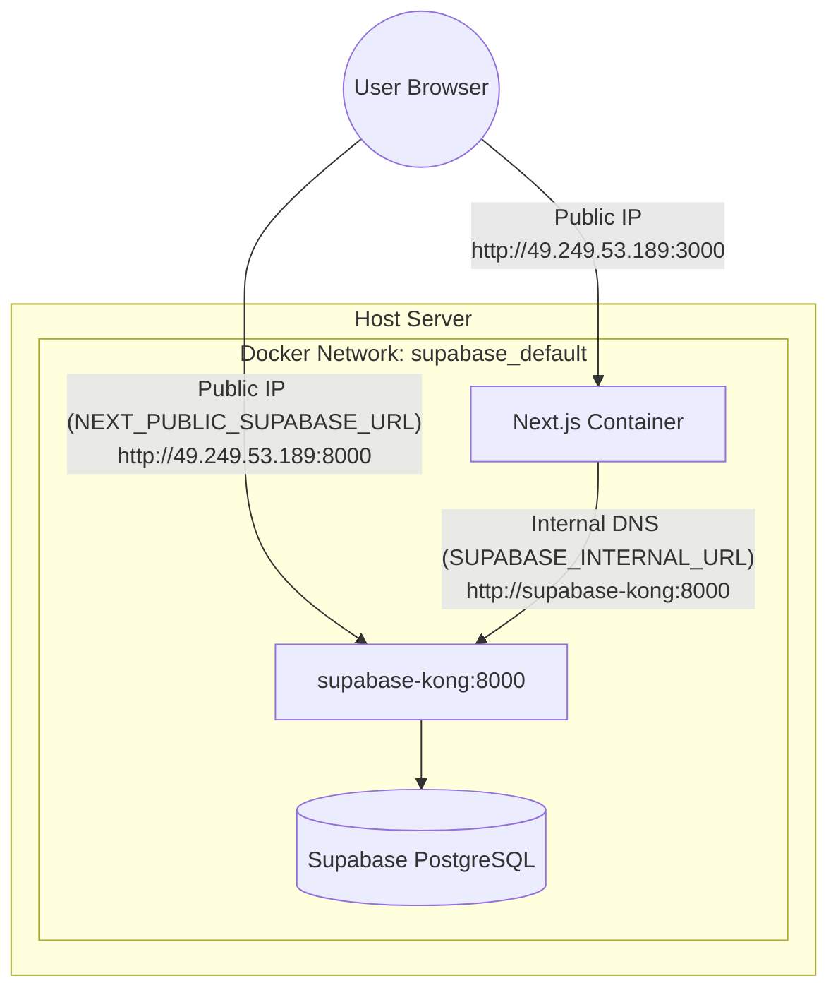

# Production Architecture for Next.js and Supabase

This document outlines the best practices and required configurations for running your Next.js application alongside Supabase inside a production Docker environment.

> [!IMPORTANT]  
> The core principle for production is separating **Client-Side (Browser)** networking from **Server-Side (Container)** networking. 

## The Core Problem: NAT Loopback
When your Next.js container tries to communicate with the Supabase container using your server's Public IP address (e.g., `49.249.53.189`), the request has to leave the Docker internal network, hit the host machine's networking stack, potentially go out to your router/firewall, and route back in. 

This causes two major issues:
1. **Timeouts / Hanging Logins**: Many cloud providers or network setups block NAT loopback (hairpinning), causing requests to hang indefinitely.
2. **Performance/Security**: Traffic unnecessarily traverses external networking interfaces instead of using the lightning-fast, secure internal Docker bridge.

## The Solution: Split Routing
You must configure your Next.js app to use the **Public IP** for browser interactions, and the **Internal Docker DNS** for server-side interactions.

### 1. Environment Variables Setup
Your `.env.production` file (which is baked into the Next.js build) should define the public URL for the browser:
```env
# Used EXCLUSIVELY by the browser/client-side components
NEXT_PUBLIC_SUPABASE_URL=http://49.249.53.189:8000
NEXT_PUBLIC_SUPABASE_ANON_KEY=your_public_anon_key
```

Your runtime `.env.docker` file (which is passed via `--env-file` at runtime) should define the internal routing:
```env
# Used EXCLUSIVELY by Server Actions, API Routes, and SSR
SUPABASE_INTERNAL_URL=http://supabase-kong:8000
SUPABASE_SERVICE_ROLE_KEY=your_secret_service_key
```

### 2. Updating the Supabase Client Instances
You need two different initializations of the Supabase client in your codebase depending on where it runs.

**A. Browser Client (Client Components):**
This remains unchanged. It relies on the variables baked in by Next.js at build time.
```typescript
import { createBrowserClient } from '@supabase/ssr'

export function createClient() {
  return createBrowserClient(
    process.env.NEXT_PUBLIC_SUPABASE_URL!,
    process.env.NEXT_PUBLIC_SUPABASE_ANON_KEY!
  )
}
```

**B. Server Client (Server Components / API Routes):**
You must modify your server-side client utility to use the internal URL.
```typescript
import { createServerClient } from '@supabase/ssr'
import { cookies } from 'next/headers'

export function createClient(cookieStore: ReturnType<typeof cookies>) {
  return createServerClient(
    process.env.SUPABASE_INTERNAL_URL || process.env.NEXT_PUBLIC_SUPABASE_URL!,
    process.env.SUPABASE_SERVICE_ROLE_KEY || process.env.NEXT_PUBLIC_SUPABASE_ANON_KEY!,
    {
      cookies: {
        get(name: string) {
          return cookieStore.get(name)?.value
        },
        // ... set and remove implementations
      },
    }
  )
}
```
> [!TIP]
> Using the `|| process.env.NEXT_PUBLIC_SUPABASE_URL` fallback allows your code to still work locally outside of Docker during development!

### 3. Docker Deployment Architecture
When running in production, both containers must be on the same Docker network so they can resolve each other by name.



### 4. Running the Containers
When launching your application, ensure it is attached to the same network as your Supabase containers (usually `supabase_default` if using the standard Supabase docker-compose setup).

```bash
# Build the image, baking in the public variables
npm run docker:build

# Run the container attached to the supabase network
docker run -d \
  --name goalcryst-app \
  --restart unless-stopped \
  --network supabase_default \
  -p 3000:3000 \
  --env-file .env.docker \
  goalcryst-crm:latest
```

> [!CAUTION]
> If your Next.js container is not on the `--network supabase_default`, the internal DNS name `http://supabase-kong:8000` will fail to resolve.
